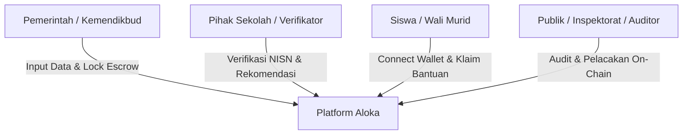
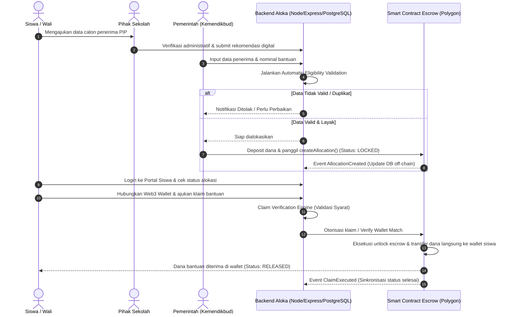
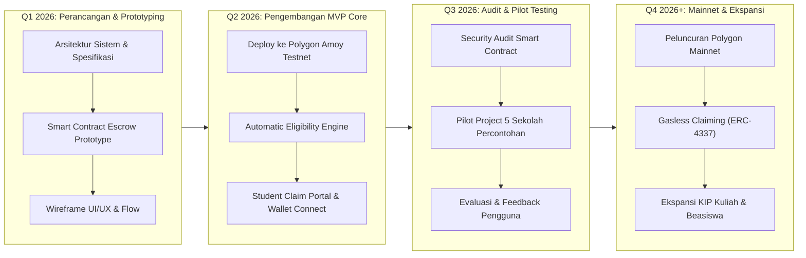

# Product Requirements Document (PRD)
# Proyek: Aloka – Platform Distribusi Bantuan Pendidikan Berbasis Web3 (Program Indonesia Pintar)

---

## 1. Informasi Dokumen & Kontrol Versi

| Properti | Detail |
| :--- | :--- |
| **Nama Produk** | Aloka |
| **Tipe Dokumen** | Product Requirements Document (PRD) |
| **Target Program** | Program Indonesia Pintar (PIP) |
| **Versi Dokumen** | v1.0.0 (MVP) |
| **Status** | Approved / Ready for Development |
| **Target Jaringan** | Polygon PoS (Testnet Amoy / Mainnet) |
| **Arsitektur** | Hybrid Web2 – Web3 |

---

## 2. Ringkasan Eksekutif (Executive Summary)

**Aloka** adalah platform distribusi bantuan pendidikan berbasis Web3 yang dirancang untuk meningkatkan transparansi, keamanan, dan akuntabilitas dalam penyaluran dana **Program Indonesia Pintar (PIP)**. PIP menyalurkan bantuan kepada jutaan siswa kurang mampu di seluruh Indonesia. Namun, pengawasan manual pada tahap akhir distribusi (*last-mile distribution*) sering menimbulkan celah penyalahgunaan, seperti penahanan kartu ATM/buku tabungan siswa, pencairan kolektif ilegal tanpa sepengetahuan penerima, pungutan liar dengan dalih biaya administrasi, hingga pemotongan dana langsung oleh oknum perantara.

Aloka mengombinasikan keunggulan sistem database konvensional (*off-chain*) dan teknologi blockchain (*on-chain*) melalui **Smart Contract Escrow** pada jaringan Polygon:
- **Pemerintah** mengelola data penerima yang valid dan mengunci alokasi dana secara langsung ke dalam smart contract vault.
- **Sekolah** memvalidasi dan memberikan rekomendasi digital atas kelayakan administratif siswa.
- **Siswa** dapat memantau status secara transparan, menghubungkan wallet Web3 yang terverifikasi, dan melakukan klaim langsung dari kontrak pintar tanpa perantara fisik.

Dengan mekanisme *trustless escrow*, dana bantuan tidak dapat dipotong atau dicairkan secara sepihak sebelum seluruh aturan validasi otomatis terpenuhi.

---

## 3. Latar Belakang Masalah & Peluang (Problem Statement & Opportunity)

### 3.1. Permasalahan Utama di Lapangan
1. **Penyalahgunaan pada *Last-Mile Distribution*:**
   Penyaluran dari bank penyalur hingga ke tangan siswa melibatkan rantai koordinasi manual yang panjang (pihak dinas, sekolah, pihak kolektif). Hal ini membuka ruang manipulasi fisik seperti penahanan kartu ATM atau buku SimPel (Simpanan Pelajar).
2. **Pencairan Kolektif Tanpa Otorisasi:**
   Oknum tertentu kerap mencairkan dana bantuan secara massal dengan dalih mewakili siswa, namun dana tersebut tidak diserahkan seutuhnya kepada siswa yang berhak.
3. **Pungutan Liar & Pemotongan Administratif:**
   Penerima sering kali menerima nominal yang tidak utuh karena adanya pemotongan sepihak untuk kas sekolah, iuran liar, atau biaya administrasi fiktif.
4. **Silo Data & Audit yang Lambat:**
   Pencatatan distribusi saat ini terpusat di server masing-masing instansi yang tertutup. Proses rekonsiliasi dan audit memerlukan waktu berbulan-bulan, sehingga kecurangan baru terdeteksi setelah dana habis terpakai.

### 3.2. Peluang & Solusi Blockchain
Teknologi blockchain menawarkan karakteristik:
- **Immutability:** Data alokasi dan riwayat transaksi tidak dapat diubah atau dimanipulasi oleh pihak manapun.
- **Transparansi Publik:** Status alokasi, saldo escrow, dan status klaim dapat diverifikasi langsung melalui blockchain explorer.
- **Otomatisasi Eksekusi (Smart Contract):** Pengurangan peran perantara manusia dalam pemindahan dana memastikan prinsip *direct-to-beneficiary*.

---

## 4. Tujuan Produk & Metrik Keberhasilan (Goals & Success Metrics)

### 4.1. Tujuan Produk (Product Goals)
- Menghadirkan sistem distribusi bantuan pendidikan yang bebas dari pemotongan dan pencairan liar.
- Memberikan visibilitas status alokasi secara *real-time* kepada siswa dan wali murid.
- Mempercepat proses audit penyaluran bantuan dari hitungan bulan menjadi hitungan detik (*real-time verifiable audit trail*).

### 4.2. Key Performance Indicators (KPIs)

| Metrik | Baseline Saat Ini | Target Aloka (MVP) |
| :--- | :--- | :--- |
| **Tingkat Kebocoran Dana (*Fund Leakage*)** | Rentan pemotongan tidak resmi | 0% (dana terkunci di escrow on-chain) |
| **Waktu Audit Distribusi** | 30 - 90 hari | < 1 menit (verifikasi instan via explorer) |
| **Ketepatan Penerima (*Beneficiary Match*)** | Validasi manual rentan joki | 100% tervalidasi via NISN & verifikasi wallet |
| **Status Visibilitas Bantuan** | Tertutup / Bertanya ke pihak sekolah | 24/7 *Self-service status tracking* oleh siswa |

---

## 5. Target Pengguna & Role-Based Access Control (RBAC)



### 5.1. Role Matrix & Wewenang

| Role | Hak Akses Utama | Tanggung Jawab |
| :--- | :--- | :--- |
| **Government (Admin Pusat)** | - Dashboard Aid Allocation<br>- Input & verifikasi master data penerima<br>- Inisiasi deposit dana ke Escrow Vault<br>- Monitoring analitik distribusi nasional | Memastikan ketersediaan anggaran, menentukan kuota alokasi, dan menyetujui batch pencairan on-chain. |
| **School (Verifikator Satuan Pendidikan)** | - Dashboard Sekolah<br>- Review data siswa dan status keaktifan<br>- Memberikan rekomendasi kelayakan digital<br>- Mengunggah bukti berkas pendukung | Memverifikasi keabsahan data siswa, mencegah siswa fiktif, serta memastikan siswa terdaftar aktif di Dapodik/sistem sekolah. |
| **Student / Wali (Penerima Manfaat)** | - Student Claim Portal<br>- Pengecekan status alokasi & escrow<br>- Integrasi Web3 Wallet<br>- Eksekusi klaim bantuan mandiri | Menghubungkan wallet pribadi yang sah dan mengklaim dana bantuan secara langsung ke wallet. |
| **Auditor / Public (Read-Only)** | - Public Ledger Explorer<br>- Verifikasi riwayat transaksi escrow<br>- Laporan rekapitulasi real-time | Mengawasi akuntabilitas penyaluran dana secara independen. |

---

## 6. Alur Sistem & Arsitektur Bisnis (Workflow)

### 6.1. Alur End-to-End Penyaluran Bantuan



---

## 7. Cakupan Fitur MVP (Functional Requirements)

### FR-1: Smart Contract Escrow Vault
- **Deskripsi:** Smart contract Solidity berbasis OpenZeppelin pada jaringan Polygon yang mengamankan dana bantuan.
- **Spesifikasi Teknis:**
  - Fungsi `createAllocation(bytes32 allocationId, address beneficiaryWallet, uint256 amount)`: Hanya dapat dipanggil oleh authorized role (Government/Admin) dengan menyertakan nilai dana transfer.
  - State Enum: `LOCKED`, `RELEASED`, `REFUNDED`.
  - Fungsi `claimAid(bytes32 allocationId)`: Memeriksa apakah pengirim (`msg.sender`) sesuai dengan `beneficiaryWallet`, status alokasi masih `LOCKED`, kemudian mentransfer dana secara instan dan mengubah status menjadi `RELEASED`.
  - Fungsi `refundAllocation(bytes32 allocationId)`: Mekanisme penarikan kembali dana oleh pemerintah apabila alokasi kedaluwarsa atau terjadi pembatalan administratif.
  - Event Emitter: `AllocationCreated`, `FundsDeposited`, `ClaimReleased`, `AllocationRefunded`.
  - Keamanan: Menggunakan `ReentrancyGuard`, `Ownable` / `AccessControl`, dan `Pausable` dari OpenZeppelin.

### FR-2: Aid Allocation Dashboard (Government)
- **Deskripsi:** Antarmuka web bagi pengelola program untuk menginput dan memantau alokasi.
- **Spesifikasi:**
  - Form & Bulk Upload (CSV/Excel) data penerima: NISN, Nama, Jenjang (SD/SMP/SMA/SMK), Nominal Bantuan.
  - Panel Review Rekomendasi Sekolah.
  - Trigger pembuatan transaksi on-chain: Batch deposit dana ke Smart Contract Escrow Vault.
  - Monitor Metrik: Total Dana Terkunci (*Total Value Locked*), Total Dana Tersalurkan, Total Klaim Berhasil, dan Daftar Pending/Gagal.

### FR-3: Automatic Eligibility Validation
- **Deskripsi:** Mesin validasi otomatis pada layer backend sebelum alokasi dibuat di blockchain.
- **Kriteria Validasi:**
  1. **Validitas NISN:** Format 10 digit angka unik dan terdaftar aktif.
  2. **Status Siswa Aktif:** Siswa terdaftar pada sekolah yang sah dan tidak berstatus keluar/lulus.
  3. **Rekomendasi Sekolah Sah:** Surat rekomendasi digital telah diverifikasi oleh akun sekolah resmi.
  4. **Pencegahan Duplikasi (*Deduplication*):** NISN yang sama tidak boleh menerima alokasi ganda dalam satu periode/tahun ajaran.
  5. **Parameter Bansos:** Memenuhi ambang batas prioritas keluarga miskin/rentan miskin (basis Data Terpadu Kesejahteraan Sosial/DTKS).

### FR-4: Student Claim Portal
- **Deskripsi:** Portal web responsif dan ramah pengguna bagi siswa dan wali murid.
- **Spesifikasi:**
  - Login sederhana berbasis validasi NISN dan Tanggal Lahir terdaftar di Dapodik.
  - Kartu Status Bantuan: Menampilkan Nominal, Sumber Dana, Status Alokasi (`LOCKED` / `SIAP DIKLAIM` / `SELESAI`).
  - Fitur Connect Web3 Wallet (didukung MetaMask, WalletConnect, Coinbase Wallet).
  - Tombol aksi satu klik: *"Klaim Bantuan Sekarang"*.
  - Riwayat Transaksi & Link Transaksi Polygonscan sebagai bukti kepemilikan.

### FR-5: Wallet Integration Module
- **Deskripsi:** Modul integrasi Web3 yang menjembatani identitas Web2 siswa dengan alamat wallet Web3.
- **Spesifikasi:**
  - Deteksi Web3 Provider pada browser siswa.
  - Proses *Signature Authentication* (*Sign-in with Ethereum / EIP-4361*) untuk membuktikan kepemilikan private key tanpa membocorkan kredensial.
  - Pemetaan (*binding*) 1-to-1 antara NISN siswa dengan Public Address Wallet yang telah diverifikasi di database off-chain.
  - Peringatan keamanan apabila alamat wallet terindikasi tidak valid atau telah terikat dengan NISN lain.

### FR-6: Claim Verification Engine
- **Deskripsi:** Komponen logika verifikasi pada backend sebelum eksekusi smart contract dijalankan.
- **Aturan Pengecekan:**
  - Pastikan wallet yang terhubung cocok dengan wallet terdaftar untuk NISN tersebut.
  - Verifikasi alokasi on-chain benar-benar berstatus `LOCKED`.
  - Pastikan tidak ada flag fraud / investigasi terbuka pada profil siswa.
  - Hasilkan kriptografis otorisasi (*claim signature* / verifikasi on-chain) sehingga smart contract hanya mengeksekusi klaim yang telah divalidasi.

### FR-7: Public Transparency & Audit Module
- **Deskripsi:** Halaman publik yang dapat diakses oleh siapa saja untuk melihat transparansi agregat tanpa mengekspos identitas pribadi (PII) siswa.
- **Spesifikasi:**
  - Visualisasi total alokasi vs realisasi per provinsi/kabupaten/jenjang.
  - Alamat smart contract escrow yang terverifikasi di Polygonscan.
  - Log audit aktivitas pencairan tanpa menampilkan nama lengkap atau NIK (hanya inisial dan tx hash).

---

## 8. Kebutuhan Non-Fungsional (Non-Functional Requirements)

### 8.1. Keamanan (Security)
- **Smart Contract Security:** Wajib lolos analisis statis (Slither/Mythril), menerapkan *Reentrancy Guard*, batas otorisasi via OpenZeppelin `AccessControl`, serta fitur *Emergency Pause* (`Pausable`).
- **Data Privacy & Perlindungan PII:** Data pribadi seperti NISN, NIK, dan Nama Siswa **hanya disimpan pada database off-chain terenkripsi** (AES-256). Blockchain hanya menyimpan *hash identifier* (`bytes32 allocationId`), alamat wallet, dan nominal dana.
- **Autentikasi & Sesi:** Menggunakan JSON Web Token (JWT) dengan *short expiry* (15 menit) dan *HttpOnly Refresh Cookies*.

### 8.2. Kinerja & Skalabilitas (Performance & Scalability)
- **Throughput:** Menggunakan Polygon PoS untuk memastikan waktu konfirmasi blok cepat (~2 detik) dan throughput hingga 1000+ TPS.
- **Efisiensi Gas Fee:** Mengelompokkan transaksi pemerintah dalam mekanisme batch (*batch allocation creation*) untuk menekan biaya gas.
- **Waktu Muat Portal:** Waktu respons API backend < 200 ms (p95), First Contentful Paint (FCP) frontend < 1.5 detik.

### 8.3. Aksesibilitas & User Experience (UX for Non-Crypto Users)
- Antarmuka Portal Siswa didesain sederhana (Mobile-First) dengan panduan pembuatan/koneksi wallet langkah demi langkah.
- Bahasa pengantar bahasa Indonesia yang formal namun mudah dipahami masyarakat umum.

---

## 9. Arsitektur Teknis & Skema Data

### 9.1. Tech Stack Matrix

| Komponen | Teknologi | Keterangan |
| :--- | :--- | :--- |
| **Frontend** | Next.js (App Router), Tailwind CSS, Lucide Icons | Server-side rendering untuk performa cepat dan UI modern. |
| **Backend** | Node.js, Express.js, TypeScript | RESTful API & validator engine. |
| **Database Off-Chain** | PostgreSQL, Prisma ORM | Relational database untuk data PII, sekolah, dan log. |
| **Blockchain** | Polygon PoS, Solidity (^0.8.20), Hardhat / Foundry | Jaringan L2/Sidechain hemat biaya gas. |
| **Smart Contract Lib** | OpenZeppelin Contracts v5.x | Standar industri untuk keamanan token & escrow. |
| **Web3 Client Lib** | Ethers.js v6 / Wagmi / Viem | Komunikasi frontend & backend dengan Polygon RPC. |
| **Autentikasi** | JWT, Bcrypt, RBAC Middleware | Keamanan akses multi-role. |

### 9.2. Skema Data Off-Chain (PostgreSQL)

```sql
-- Tabel Master Sekolah
CREATE TABLE schools (
    id UUID PRIMARY KEY DEFAULT gen_random_uuid(),
    npsn VARCHAR(10) UNIQUE NOT NULL,
    name VARCHAR(255) NOT NULL,
    address TEXT,
    created_at TIMESTAMP WITH TIME ZONE DEFAULT NOW()
);

-- Tabel Siswa (Penerima Manfaat)
CREATE TABLE students (
    id UUID PRIMARY KEY DEFAULT gen_random_uuid(),
    nisn VARCHAR(10) UNIQUE NOT NULL,
    full_name VARCHAR(255) NOT NULL,
    school_id UUID REFERENCES schools(id),
    grade_level VARCHAR(10) NOT NULL, -- SD, SMP, SMA, SMK
    wallet_address VARCHAR(42),
    is_active BOOLEAN DEFAULT TRUE,
    created_at TIMESTAMP WITH TIME ZONE DEFAULT NOW()
);

-- Tabel Rekomendasi Sekolah
CREATE TABLE school_recommendations (
    id UUID PRIMARY KEY DEFAULT gen_random_uuid(),
    student_id UUID REFERENCES students(id),
    school_id UUID REFERENCES schools(id),
    recommendation_letter_ref VARCHAR(100),
    is_approved BOOLEAN DEFAULT TRUE,
    submitted_at TIMESTAMP WITH TIME ZONE DEFAULT NOW()
);

-- Tabel Alokasi Bantuan
CREATE TABLE aid_allocations (
    id UUID PRIMARY KEY DEFAULT gen_random_uuid(),
    allocation_id_hash VARCHAR(66) UNIQUE NOT NULL, -- bytes32 on-chain
    student_id UUID REFERENCES students(id),
    amount_in_wei NUMERIC(78, 0) NOT NULL,
    academic_year VARCHAR(20) NOT NULL,
    validation_status VARCHAR(30) DEFAULT 'PENDING', -- PENDING, VALID, REJECTED
    onchain_status VARCHAR(30) DEFAULT 'UNALLOCATED', -- UNALLOCATED, LOCKED, RELEASED, REFUNDED
    tx_deposit_hash VARCHAR(66),
    tx_claim_hash VARCHAR(66),
    created_at TIMESTAMP WITH TIME ZONE DEFAULT NOW(),
    updated_at TIMESTAMP WITH TIME ZONE DEFAULT NOW()
);
```

### 9.3. Struktur Data On-Chain (Smart Contract Solidity Interface)

```solidity
// SPDX-License-Identifier: MIT
pragma solidity ^0.8.20;

interface IAlokaEscrowVault {
    enum EscrowStatus { NONE, LOCKED, RELEASED, REFUNDED }

    struct Allocation {
        bytes32 allocationId;
        address beneficiary;
        uint256 amount;
        EscrowStatus status;
        uint256 createdAt;
        uint256 claimedAt;
    }

    event AllocationCreated(bytes32 indexed allocationId, address indexed beneficiary, uint256 amount);
    event AidClaimed(bytes32 indexed allocationId, address indexed beneficiary, uint256 amount);
    event AidRefunded(bytes32 indexed allocationId, uint256 amount);

    function createAllocation(bytes32 allocationId, address beneficiary) external payable;
    function claimAid(bytes32 allocationId) external;
    function refundAllocation(bytes32 allocationId) external;
    function getAllocation(bytes32 allocationId) external view returns (Allocation memory);
}
```

---

## 10. Manajemen Risiko & Penanganan Edge Cases

| Skenario Risiko / Edge Case | Dampak | Strategi Mitigasi Aloka |
| :--- | :--- | :--- |
| **Siswa tidak memiliki/belum paham cara membuat Web3 Wallet** | Hambatan adopsi pencairan dana | Sediakan modul panduan onboarding visual + opsi integrasi Account Abstraction (ERC-4337) / Social Login (Google/SMS via Web3Auth) di fase berikutnya. |
| **Siswa kehilangan akses ke Private Key sebelum klaim** | Dana berpotensi terkunci | Siswa melapor ke sekolah untuk validasi ulang identitas; pemerintah dapat memicu fungsi `refundAllocation()` atau mutasi wallet penerima melalui multi-signature approval. |
| **Volatilitas Nilai Kripto (MATIC)** | Nilai bantuan fluktuatif | Disarankan menggunakan stablecoin patokan rupiah (seperti IDRX/IDRT berbasis ERC-20) atau mata uang fiat on-ramp tokenized agar nilai bantuan tetap stabil sesuai ketentuan PIP. |
| **Upaya Klaim Menggunakan Wallet Asing (Joki/Oknum)** | Percobaan pencurian dana | Smart Contract secara ketat memverifikasi `msg.sender == beneficiaryWallet` yang terikat pada `allocationId`. Upaya klaim dari wallet asing akan langsung gagal (*reverted*). |
| **Lonjakan Gas Fee Jaringan Polygon** | Biaya klaim membebani siswa | Menerapkan EIP-2771 / Gas Station Network (Meta-Transactions) di mana pemerintah atau platform mensubsidi gas fee transaksi siswa (*gasless claiming*). |

---

## 11. Roadmap Produk & Rencana Implementasi



---

## 12. Kesimpulan & Langkah Selanjutnya

Dokumen PRD ini mendefinisikan ruang lingkup dan spesifikasi komprehensif bagi platform **Aloka** untuk menyelesaikan persoalan *last-mile distribution* pada Program Indonesia Pintar. Dengan menggabungkan validasi database terintegrasi dan eksekusi terdesentralisasi via Polygon Smart Contract Escrow, Aloka menghadirkan akuntabilitas total yang dapat diaudit publik secara *real-time*.

### Langkah Selanjutnya bagi Tim Pengembang:
1. Setup repositori monorepo / multi-package (Kontrak Pintar, Backend API, Frontend Next.js).
2. Pengembangan dan unit testing Smart Contract Escrow Vault menggunakan Hardhat/Foundry.
3. Inisialisasi basis data PostgreSQL dan API backend untuk manajemen alokasi dan verifikasi NISN.
4. Integrasi Web3 provider dan pengujian klaim end-to-end di Testnet Polygon.
